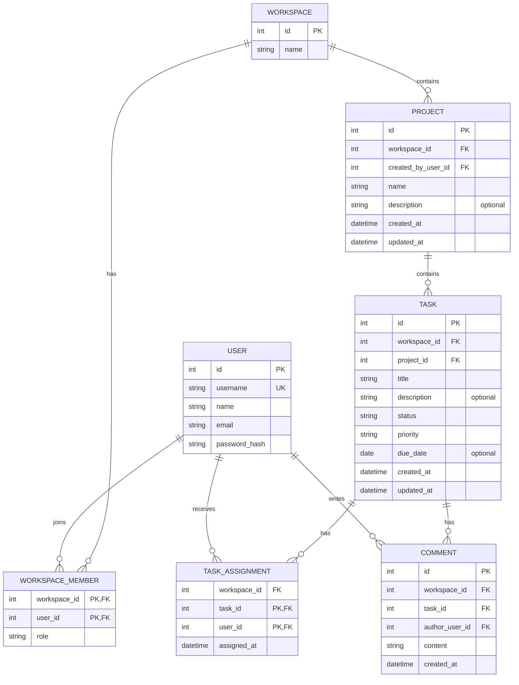

# Modelo de dados proposto

O modelo abaixo descreve a implementação académica da Ficha 03 em SQLite. As funcionalidades continuam a ser propostas para validação; o esquema e os IDs inteiros são decisões locais do exercício, não uma decisão de produção.

## Entidades

| Entidade | Identificador e atributos essenciais | Observações |
|---|---|---|
| `Workspace` | `id`, `name` | Espaço que delimita membros, projetos e acesso aos dados. O nome é uma necessidade estrutural proposta, ainda não detalhada nos requisitos. |
| `User` | `id`, `username`, `name`, `email`, `password_hash` | Conta local fictícia. Só é persistido o hash da palavra-passe; o login público não faz parte do âmbito. |
| `WorkspaceMember` | (`workspace_id`, `user_id`), `role` | Associação de utilizador a espaço. `role` tem os valores propostos `admin` e `member`. |
| `Project` | `id`, `workspace_id`, `created_by_user_id`, `name`, `description`, `created_at`, `updated_at` | Pertence a exatamente um espaço; quem o criou é registado pelo servidor. Nome obrigatório; descrição opcional. |
| `Task` | `id`, `workspace_id`, `project_id`, `title`, `description`, `status`, `priority`, `due_date`, `created_at`, `updated_at` | Pertence a exatamente um projeto. Estado `TODO`/`IN_PROGRESS`/`DONE`; prioridade `LOW`/`MEDIUM`/`HIGH`. |
| `TaskAssignment` | (`task_id`, `user_id`), `workspace_id`, `assigned_at` | Entidade associativa para a relação N:M; chave impede atribuições repetidas e FK composta exige membro do mesmo espaço. |
| `Comment` | `id`, `workspace_id`, `task_id`, `author_user_id`, `content`, `created_at` | Autor e data são definidos no servidor; comentário pertence a uma tarefa e a um membro do mesmo espaço. |

## Relacionamentos e regras

- Um `Workspace` tem zero ou muitos `WorkspaceMember`; cada associação liga exatamente um `User` a um espaço.
- Um `Workspace` contém zero ou muitos `Project`; cada projeto pertence a exatamente um espaço.
- Um `Project` contém zero ou muitas `Task`; cada tarefa pertence a exatamente um projeto.
- Um `User` pode estar associado a zero ou muitos espaços, através de `WorkspaceMember`.
- Uma tarefa pode ter zero ou muitos responsáveis, e um membro pode estar associado a zero ou muitas tarefas, através de `TaskAssignment`.
- Uma tarefa tem zero ou muitos `Comment`; cada comentário tem exatamente um autor que é membro do mesmo espaço.
- `Task.status` só aceita `TODO`, `IN_PROGRESS` e `DONE`; uma tarefa nova começa em `TODO`. A interface apresenta os rótulos portugueses.
- `Task.priority` só aceita `LOW`, `MEDIUM` e `HIGH`; uma tarefa nova começa em `MEDIUM`.
- O progresso não precisa de ser persistido: total = número de tarefas do projeto; percentagem = tarefas `Concluída` / total × 100; total zero resulta em 0%.
- Exclusão de espaços, projetos, membros e utilizadores, bem como retenção e auditoria, continuam por definir.

## Diagrama ER

Para assegurar que a tarefa e o projeto pertencem ao mesmo espaço, o modelo usa a chave única `Project (workspace_id, id)` referenciada por `Task (workspace_id, project_id)`. A mesma regra restringe atribuições e autores de comentários através de chaves para `WorkspaceMember (workspace_id, user_id)`. A chave primária de `TaskAssignment (task_id, user_id)` impede duplicação.

Cardinalidades, estados, prioridades e regras de colaboração seguem as propostas da Ficha 03 em [`requirements.md`](requirements.md) e [`user-stories.md`](user-stories.md). Papéis, espaços e elegibilidade continuam pressupostos académicos não confirmados pelo cliente.